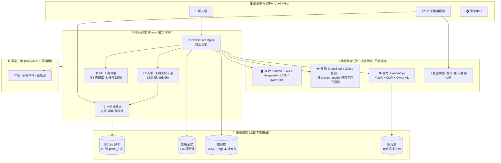

# 🏗️ Harven AI Architecture — The Whitepaper

> **EN TL;DR**: Harven is a local-first family AI hub. Three design laws run everything:
> ① Language understanding → the model; Data extraction → local code (milliseconds); Result assembly → model turns it into human speech.
> ② The Butler is NOT an LLM agent — it's a declarative rule engine on a 30s heartbeat, costing **zero API tokens** in daily operation.
> ③ Everything (ledgers, conversations, memories, embeddings) lives on your disk. The cloud (HarvenHub) is an optional relay you can self-host.
>
> 中文完整版在下方。 👇

---

# 中文版：哈文架构白皮书

## 0️⃣ 一句话定位

**哈文不是聊天框套壳，是一台装在你家电脑上的「家庭 AI 中台」**：29 个垂直面板（记账/冰箱/健康/车辆/孩子成长/管家…）共享一个本地数据底座，AI 负责听懂人话和把结果说成人话。

---

## 1️⃣ 三条铁律（所有设计的源头）

| 铁律 | 内容 | 为什么 |
|---|---|---|
| **理解→模型** | 只有「听懂人话」这一步用大模型 | 模型贵、慢、不稳定，能用机器的地方绝不用模型 |
| **提取→本地毫秒级** | 记账金额、冰箱品名、日程时间全靠本地正则/词典毫秒级提取 | 数据不出门 + 速度 + 零成本 |
| **注入→模型组织人话** | 把结构化结果交给模型「翻译」成自然语言 | 模型最擅长的就是这个 |

```
用户说「47.6 炸酱面」
  → 本地词典 0.1s 提取 {金额:47.6, 品名:炸酱面, 类型:餐饮}   ← 铁律②
  → 写入本地账本 SQLite                                       ← 铁律②
  → 模型生成「记好了，午餐 47.6 元」                          ← 铁律①③
```

---

## 2️⃣ 全景架构图



---

## 3️⃣ 关键设计决策（为什么不走大家都走的路）

> **这是本文档最重要的部分**——同行关心的不是「有什么功能」，是「为什么这么选」。

### 决策 1：管家不是大模型智能体，是「声明式规则引擎 + 30 秒心跳」

- **大家都这么做**：接一个 Agent 框架，让 LLM 循环思考。
- **哈文的选择**：管家 = 规则声明（超支检测/沉睡唤醒/过期清理…）+ 30 秒本地心跳扫描，**日常运行 0 token**。LLM 只在两处出场：夜间简报生成、记忆蒸馏。
- **代价**：管家的「聪明」上限低。**换来的是**：可以 7×24 常驻不心疼钱——这是家庭场景的命门（谁敢让 LLM 每分钟醒一次看账本？）。

### 决策 2：工具执行走「B 方案 + FC」双轨

- **B 方案（关键词快车道）**：常见指令（打开 D 盘/记一笔/查天气）本地词典直接命中，**无网络、毫秒级、离线可用**。
- **FC（Function Calling）**：53 个内置工具，复杂多步任务才请模型出山。
- 不做关键词自动分发——**模式切换永远由用户在 UI 点**，不让 AI 替用户做主。

### 决策 3：模型选择权 100% 在用户手里

- 哈文**严禁代选/偷换/自动兜底「更好的模型」**。用户选的模型没能力（比如不能看图）→ 如实报错，提醒用户自己去换。
- 外脑按 `current_model` 阵营直连、**不回落**——失败就报错美化透传，不偷偷换模型装作没事。

### 决策 4：记忆系统有「梦境」，且梦境只用本地模型

- 每小时「轻梦」：记忆去重 + 碎片合并；每天凌晨「深梦」：蒸馏沉淀。五层记忆保证「永不遗忘」。
- 血泪教训（#1510）：梦境曾因路由失误每小时唤醒 8B 视觉模型白占显存、更早还偷跑过外脑计费 1068 次——现在梦境**锁死本地通道**（Ollama 文本模型 → 进程内 GGUF 兜底），合并失败宁可下轮重来也绝不进云。

### 决策 5：数据提取永远本地，隐私是架构属性不是功能

- 账本/对话/记忆/嵌入向量全在本地磁盘 SQLite + FAISS；嵌入模型（bge-small-zh）本地跑。
- 唯一联网组件 HarvenHub（市场+手机中转）**可整体自建**（Docker 一键部署包），官方云不用也完整可用。

### 决策 6：安装包自带 Python 3.13 运行时，小白双击即用

- 不要求用户装任何依赖。解压 → 双击 `安装哈文.bat` → 浏览器自动打开。
- 三档体积：轻量 50MB（视觉模型按需下载）/ 标准 709MB / 完全体 3.9GB（完全离线零下载）。

### 决策 7：受控进化——AI 可以改代码，但戴着镣铐

- AI 提案 → 用户审批 → 自动落码（带回滚）。核心文件（engine/web_app）在黑名单里 AI 碰不了。
- 现实取舍：这功能激进，所以默认关闭、路径白名单、全程留痕。

---

## 4️⃣ 代码入口地图（给想读源码的你）

| 想看什么 | 去哪 |
|---|---|
| 对话主链路/分段/播放快车道 | `src/core/engine.py` |
| 53 个内置工具注册表 | `src/core/builtin_tools.py` → `TOOL_REGISTRY` |
| 管家规则引擎/心跳 | `src/core/butler_agenda.py` |
| 面板体系（29 面板/三级抽取） | `src/core/panel_manager.py` + `panel_assist.py` |
| 本地推理（GGUF/Ollama 递进） | `src/core/local_infer.py` |
| 记忆梦境 | `src/core/memory_dreaming.py` |
| 视觉管线 HarvenEye | `src/vision/` |
| 自建云端服务端 | 另见 [HarvenHub 自建部署包](https://github.com/AmenMonk/Harven/releases/tag/selfhost-harvenhub-v2) |

## 5️⃣ 技术栈一览

`Python 3.13` · `Flask` · `Vue3 + Vite (SPA)` · `SQLite` · `FAISS` · `Ollama / llama-cpp-python` · `YOLO(ONNX)` · `CLIP` · `APScheduler` · `WebSocket`

---

> 💬 **聊架构 / 提质疑 / 报场景**：欢迎开 [Discussion](https://github.com/AmenMonk/Harven/discussions) 或 Issue——尤其是「我家想让 AI 管的一件事」，真场景会进 Roadmap。
