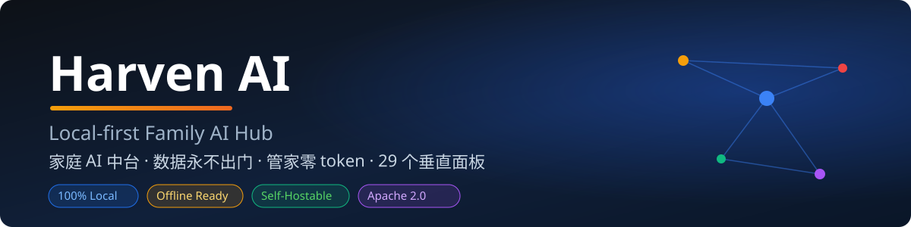

<div align="center">
  
</div>

# Harven AI — Your Family's Local AI Hub · 家庭 AI 中台

**English** | **[简体中文](README.zh-CN.md)**

**Not another chat UI. A family AI hub: local brain thinks, external brain analyzes, vertical models execute. 29 practical panels (bills, fridge, health, butler agenda…) on one local data foundation. Your data never leaves home.**

> 🇨🇳 **中文一句话**：装在你家电脑上的 AI 中台——聊天框听得懂人话，29 个面板管好记账/冰箱/健康/日程，**管家日常运行零 API 费**，所有数据只存在你自己硬盘上。解压双击即用，自带 Python 环境。

[](LICENSE)
[](#downloads)
[](#downloads)
[](#bilingual)
[](ARCHITECTURE.md)

---

## 📥 Downloads (v0.3.2 r51)

| Package | Size | Includes | Best for |
|---------|------|----------|----------|
| **[Windows 标准版](https://github.com/AmenMonk/Harven/releases/latest)** | ~709 MB | Python 3.13 + YoloX + chinese-clip | Most users (album auto-classify works out-of-box) |
| **[Windows 轻量版](https://github.com/AmenMonk/Harven/releases/latest)** | ~50 MB | Python 3.13 + YoloX | Minimal footprint (vision models download on demand) |
| **[Windows 完全体](https://github.com/AmenMonk/Harven/releases/latest)** | ~3.9 GB (3 split parts) | + Qwen3-VL-4B vision brain + llama-cpp | Fully offline, zero-download experience |
| Linux / macOS | coming soon | — | Code is cross-platform; packages on the way |

**No Python installation required** — built-in Python 3.13 runtime. Extract → double-click `安装哈文.bat` → done. One click, no wizards.

> 📦 磁盘镜像：[HarvenHub](https://harvenhub.com) 同步提供全部安装包下载。

---

## 🤔 Why Harven AI?

| Feature | Harven AI | ChatGPT | OpenWebUI | OpenClaw |
|---------|-----------|---------|-----------|----------|
| **Privacy** | ✅ 100% local | ❌ Cloud | ✅ Local | ✅ Local |
| **Cost** | ✅ Free forever | ❌ $20/mo | ✅ Free | ✅ Free |
| **Offline** | ✅ Works offline | ❌ No | ✅ Yes | ✅ Yes |
| **Memory** | ✅ 5-layer, never forgets | ❌ Forgets across chats | ⚠️ Session only | ⚠️ File-based |
| **Knowledge Base** | ✅ Built-in FAISS + 40 formats | ❌ None | ❌ None | ⚠️ Via plugins |
| **Multi-model Collaboration** | ✅ Analyze→Tune→Execute | ❌ Single model | ❌ Single model | ❌ Single model |
| **Vertical Models** | ✅ Music/Image/Voice/Medical | ⚠️ Limited | ❌ None | ❌ None |
| **AI Builds UI Panels** | ✅ AI generates panels | ❌ No | ❌ No | ❌ No |
| **Self-Modifying Code** | ✅ Controlled evolution | ❌ No | ❌ No | ❌ No |
| **Skill + Bundle Ecosystem** | ✅ HarvenHub market | ❌ Plugins | ⚠️ Limited | ✅ Skills |
| **IoT Device Control** | ✅ AI-generated drivers | ❌ No | ❌ No | ❌ No |
| **Open Source** | ✅ Apache 2.0 | ❌ Closed | ✅ Open | ✅ MIT |

---

## 🌟 Core Innovations (4 Unique Features)

### 1. 🧬 Controlled Evolution (独创)
AI modifies its own code — safely.
```
User: "帮我加一个天气查询功能"
  → Harven generates code proposal
  → User reviews description
  → Approve / Reject
  → Apply (with rollback)
```
**Can modify:** skills/ templates/ static/ config.yaml
**Cannot touch:** engine.py web_app.py (core blacklist)

### 2. 🧠 5-Layer Memory (永不遗忘)
| Layer | Function |
|-------|----------|
| L0 Raw Dialog | Full SQLite persistence, never lost |
| L1 Task Memory | AI semantic extraction, structured storage |
| L2 Long-term | Cross-dialog knowledge consolidation |
| Active Retrieval | Auto-pull relevant history during chat |
| Owner Profile | Remembers your preferences, identity, habits |

*vs ChatGPT: forgets everything when chat ends. vs OpenClaw: file-based MEMORY.md.*

### 3. 🤝 Collaboration Pipeline (多模型接力流水线)
| Capability | Description |
|-----------|-------------|
| **自由编排** | Chain any participants: external brains / local models / HarvenEye / generation stations — in any order |
| **分段命令** | Type `歌词创作 / 音乐生成 / 品评` — slashes become pipeline stages |
| **HarvenEye 站** | The vision brain (YOLO + CLIP + VLM) works as a pipeline station too |

*Single-model chatbots can't do this. Harven orchestrates multiple models like a team.*

### 4. 🎨 Vertical Model Orchestration (专业执行)

> 💡 **All vertical models are optional** — packages ship with no models bundled. Download what fits your hardware and needs from the Model Center; skip them entirely and everything else works. HarvenEye's base VLM is swappable too (bigger = smarter, smaller = lighter on VRAM).

| Model | Capability |
|-------|-----------|
| ACE-Step (optional) | Full-song generation (lyrics + style → WAV/MP3, auto-transcoded, in-chat player) |
| Stable Diffusion (optional) | Image generation |
| HarvenEye | Vision brain: YOLO detection + CLIP semantics + **swappable VLM base** + face engine; also a local general model that can handle general tasks (Q&A etc.) — capability scales with the base model |
| Face Engine | YuNet detection + SFace embedding: recognize family members, auto-organize photo albums |
| MiniCPM-V (optional) | Image understanding |
| HuaTuo (optional) | Medical Q&A |

*Vertical models execute independently — no knowledge base/skills/persona interference.*

---

## 🗺️ Feature Panorama (25+ Features)

### 💬 Conversation & Reasoning
- 🏠 **Local Mode** — Local model + knowledge base + skills + persona, **all toggleable**: knowledge base has a master switch (off = embedding model never loads, faster first reply), skills trigger on-demand by keyword, persona is customizable or empty — a bare local model works fine
- 🤖 **External Brain** — GPT/DeepSeek/GLM/Doubao + knowledge base + skills
- 🎨 **Vertical Mode** — Music/image/voice/medical specialized execution
- ⛓️ **Collaboration Pipeline** — Multi-model relay with drag-and-drop staging, save = live
- 👁️ **HarvenEye** — Vision brain: object detection, album classify, photo Q&A, face recognition
- 🏠 **Butler Agenda** — 0-token declarative rule engine, 30s heartbeat watch over your life data
- 🌐 **Web Search** — Bing built-in + SearXNG enhancement
- 🎙️ **Voice Input** — faster-whisper STT, language follows UI

### 🧠 Memory & Knowledge
- 📚 **3-Layer Knowledge Base** — Documents (40+ formats) → FAISS vectors → Auto-injection
- 🧠 **5-Layer Memory** — L0 raw + L1 task + L2 long-term + active retrieval + owner profile
- 🗂️ **Knowledge Packs** — Shareable knowledge bundles
- 📦 **Bundle** — Skill + Agent + Knowledge one-click solution

### 🔧 Tools & Automation
- ⚡ **Skill System** — Executable scripts orchestrating multi-model tasks
- 🤖 **Agent (专项培养)** — Role-based personas with trigger-word routing
- 📊 **UI Panel System** — 29 life panels (accounting / fridge / vehicle / health / kids growth) + AI-built custom panels (iframe sandbox)
- 🖼️ **Photo Engine** — Auto album classification, auto tag, bill-photo analysis pipeline
- 🔄 **Workflow Editor** — Visual flow orchestration
- ⏰ **Scheduled Tasks** — apscheduler-based automation
- 📡 **Monitor Center** — Auto-track topic updates
- 🧬 **Controlled Evolution** — AI modifies its own code (user-approved)

### 🔒 Security & Privacy
- 🛡️ **3-Layer Defense** — File scan (5 checks) + Code sandbox (Docker) + Device fingerprint
- 🦠 **Antivirus** — ClamAV integration
- 🔐 **Data Vault** — Encrypted sensitive info storage
- 🔑 **Privacy Levels** — Control what external brain sees
- 🆔 **Device Binding** — Prevent unauthorized cloning

### 🌐 Connectivity
- 📱 **Mobile Link** — Scan QR for remote chat
- 📧 **Email** — Fetch/send/search mail once configured (4 built-in tools)
- 💬 **IM Channels** — WeChat Work / DingTalk / Feishu
- 🏠 **IoT Control** — MQTT/HTTP/WebSocket + **AI-generated drivers**
- 🌍 **Public Network** — Access from phone anywhere
- 🛒 **HarvenHub Market** — Community skill/agent/bundle sharing

### 🎨 Customization
- 🌗 **Themes** — Dark/Light/System
- 📝 **Bilingual i18n** — 中文/English (853 keys, full coverage)
- 🎨 **Brand Customization** — Custom name/icon/avatar
- 💾 **Backup & Restore** — One-click data vault
- 🛠️ **Fallback Mode** — Auto-recovery from failures

---

## 🚀 Quick Start

### Windows (v0.3.2)
```bash
# 1. Download HarvenAI_v0.3.2_standard_Windows_r51.zip  (~709 MB)
# 2. Extract
# 3. Double-click 安装哈文.bat   ← one click, fully automatic
# 4. Browser opens http://localhost:7000
# 5. Default password: harven2026 (forced change on first login)
```

### Linux / macOS
Packages coming soon. Meanwhile, run from source:
```bash
git clone https://github.com/AmenMonk/Harven.git
cd Harven
python -m venv venv && source venv/bin/activate   # Windows: venv\Scripts\activate
pip install -r requirements.txt
cp config.yaml.example config.yaml
python web_app.py
```

**No Python installation needed** for the Windows package — Python 3.13 runtime is built in.

---

## 🏗️ Technical Architecture

> 📐 **Full whitepaper: [ARCHITECTURE.md](ARCHITECTURE.md)** — design decisions, data flow diagrams, code entry map. Why the Butler costs zero tokens, why data extraction is local-first, why models never get swapped behind your back.

Three design laws run everything:

| Law | Rule |
|-----|------|
| ① | **Language understanding → the model.** Only this step uses LLM. |
| ② | **Data extraction → local code.** Regex/dictionary, milliseconds, offline, private. |
| ③ | **Result assembly → the model.** LLM turns structured results into human speech. |

### By the Numbers

| Metric | Value |
|--------|-------|
| **Python modules** | 113 |
| **REST API endpoints** | 80+ |
| **Lines of code** | 160,000+ |
| **Built-in skills** | 10 |
| **i18n keys** | 853 (zh_CN + en_US) |
| **Supported file formats** | 40+ (txt/md/csv/pdf/docx/xlsx/pptx) |

### Tech Stack
| Layer | Technology |
|-------|-----------|
| **Backend** | Python + Flask + SQLite + FAISS |
| **Frontend** | HTML + Bootstrap5 + JavaScript (SSE streaming) |
| **AI** | Ollama (local) + DeepSeek/GLM/Doubao/OpenAI (external) |
| **Vertical Models** | MusicGen / Stable Diffusion / Bark / MiniCPM-V / HuaTuo |
| **Desktop** | pywebview (optional) |
| **Voice** | faster-whisper (STT) |
| **Search** | Bing + SearXNG |
| **Sandbox** | Docker (preferred) / subprocess (fallback) |

### Cross-Platform Support
| Platform | Python Source | Package Manager | Screenshot | Trash |
|----------|-------------|-----------------|------------|-------|
| Windows | Built-in 3.13 | winget | Win+Shift+S | Clear-RecycleBin |
| Linux | Built-in 3.13.15 | apt/yum/pacman | scrot | rm ~/.local/share/Trash |
| macOS | Built-in 3.13.15 (Universal) | brew | screencapture | rm ~/.Trash |

---

## 🌍 Bilingual (中英双语)

Harven AI is fully bilingual — interface, AI responses, voice recognition, and system messages all switch together.

| Component | 中文 | English |
|-----------|------|---------|
| UI (28 tabs) | ✅ | ✅ |
| AI responses | ✅ | ✅ |
| Voice STT | zh | en |
| Command routing | ✅ | ✅ |
| FC prompts | ✅ | ✅ |

Settings → Language → "界面与回答语言" → 跟随系统 / 简体中文 / English

---

## 🤝 Contributing

Contributions welcome! 

1. Fork the repository
2. Create feature branch: `git checkout -b feature/your-feature`
3. Commit: `git commit -m "Add: your feature"`
4. Push: `git push origin feature/your-feature`
5. Open a Pull Request

### Development Setup
```bash
git clone https://github.com/AmenMonk/Harven.git
cd Harven
python -m venv venv
source venv/bin/activate  # Linux/macOS
# venv\Scripts\activate   # Windows
pip install -r requirements.txt
cp config.yaml.example config.yaml
python web_app.py
```

### Project Structure
```
HarvenAI/
├── src/core/          # 30+ kernel modules (engine, memory, security, etc.)
├── skills/            # 10 built-in skills (accounting, code audit, music, etc.)
├── templates/         # Web UI (index.html + 28 setting tabs)
├── static/            # JS/CSS/icons
├── locales/           # i18n (zh_CN.json + en_US.json)
├── data/              # User data (sqlite, faiss, knowledge, skills)
├── docs/              # Documentation center
├── web_app.py         # Flask web server (80+ API endpoints)
└── platform.py        # Cross-platform abstraction
```

---

## 📄 License

**Apache License 2.0** — Free to use, modify, and distribute.

---

## 👤 Author

**AmenMonk** · 📧 38552540@qq.com

> **Harven AI** — Your personal AI brain that lives on your computer, not in the cloud.
> 
> 哈文 — 住在电脑里的AI大脑，数据主权在你手里。

---

## ⭐ Star History

If you find Harven AI useful, please consider giving it a star! ⭐

[](https://star-history.com/#AmenMonk/Harven&Date)
