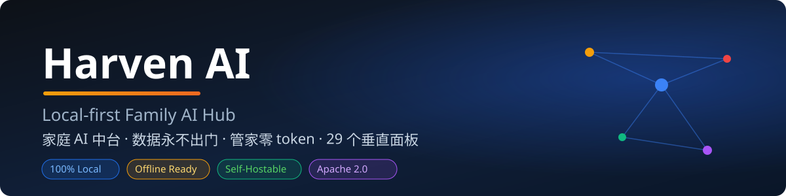

<div align="center">
  
</div>

# 哈文 AI — 装在你家电脑上的家庭 AI 中台

**English** | **[简体中文](README.zh-CN.md)**

> **一句话**：聊天框听得懂人话，29 个面板管好记账/冰箱/健康/日程/孩子成长，**管家日常运行零 API 费**，所有数据只存你自己的硬盘。解压双击即用，Python 环境都给你带好了。

[](LICENSE)
[](#下载安装)
[](#下载安装)
[](ARCHITECTURE.md)

---

## 📥 下载安装（v0.3.2 r51）

| 安装包 | 体积 | 内含 | 适合谁 |
|---------|------|----------|----------|
| **[Windows 标准版](https://github.com/AmenMonk/Harven/releases/latest)** | ~709 MB | Python 3.13 + YoloX + chinese-clip | 大多数用户（相册自动分类开箱即用） |
| **[Windows 轻量版](https://github.com/AmenMonk/Harven/releases/latest)** | ~50 MB | Python 3.13 + YoloX | 精简党（视觉模型联网后按需下载） |
| **[Windows 完全体](https://github.com/AmenMonk/Harven/releases/latest)** | ~3.9 GB（3 个分卷） | + Qwen3-VL-4B 视觉大脑 + llama-cpp | 完全离线、下载一次到位 |
| Linux / macOS | 敬请期待 | — | 代码本身跨平台，安装包在路上 |

**不需要装 Python**——运行时已内置。解压 → 双击 `安装哈文.bat` → 浏览器自动打开，全程一次点击没有下一步。

> 📦 备用通道：[HarvenHub](https://harvenhub.com) 同步提供全部安装包。

---

## 🤔 哈文和它们有什么不一样？

| 能力 | 哈文 | ChatGPT | OpenWebUI | OpenClaw |
|---------|-----------|---------|-----------|----------|
| **隐私** | ✅ 100% 本地 | ❌ 云端 | ✅ 本地 | ✅ 本地 |
| **费用** | ✅ 永久免费 | ❌ $20/月 | ✅ 免费 | ✅ 免费 |
| **离线可用** | ✅ 断网全功能 | ❌ 不行 | ✅ 可以 | ✅ 可以 |
| **记忆** | ✅ 五层记忆，永不遗忘 | ❌ 关窗就忘 | ⚠️ 仅会话内 | ⚠️ 靠文件 |
| **知识库** | ✅ 内置 FAISS + 40 种格式 | ❌ 无 | ❌ 无 | ⚠️ 靠插件 |
| **多模型协作** | ✅ 分析→调校→执行 接力流水线 | ❌ 单模型 | ❌ 单模型 | ❌ 单模型 |
| **垂直模型** | ✅ 音乐/图片/语音/医疗 | ⚠️ 有限 | ❌ 无 | ❌ 无 |
| **AI 造面板** | ✅ AI 自动生成 UI 面板 | ❌ 无 | ❌ 无 | ❌ 无 |
| **受控自我进化** | ✅ AI 改代码（用户审批） | ❌ 无 | ❌ 无 | ❌ 无 |
| **Skill + Bundle 生态** | ✅ HarvenHub 市场 | ❌ 插件 | ⚠️ 有限 | ✅ Skills |
| **IoT 设备控制** | ✅ AI 生成驱动 | ❌ 无 | ❌ 无 | ❌ 无 |
| **开源协议** | ✅ Apache 2.0 | ❌ 闭源 | ✅ 开源 | ✅ MIT |

---

## 🌟 四个独创机制

### 1. 🧬 受控进化（AI 改自己的代码，但戴着镣铐）
```
用户: "帮我加一个天气查询功能"
  → 哈文生成代码提案
  → 用户看说明审批
  → 同意 / 拒绝
  → 落码（可回滚）
```
**能改**：skills/ templates/ static/ config.yaml
**不能碰**：engine.py web_app.py（核心黑名单）

### 2. 🧠 五层记忆（永不遗忘）
| 层 | 干什么 |
|-------|----------|
| L0 原始对话 | SQLite 全量落盘，一条不丢 |
| L1 任务记忆 | AI 语义抽取，结构化存储 |
| L2 长期记忆 | 跨对话知识沉淀 |
| 主动召回 | 聊天时自动拉相关历史 |
| 主人画像 | 记住你的偏好、身份、习惯 |

### 3. 🤝 多模型接力流水线
| 能力 | 说明 |
|-----------|-------------|
| **自由编排** | 外脑 / 本地模型 / HarvenEye / 生成站任意串联，拖拽即编排，保存即生效 |
| **分段命令** | 一句话里用 `/` 分段：`歌词创作 / 音乐生成 / 品评`，斜杠变流水线工位 |
| **HarvenEye 工位** | 视觉大脑（YOLO + CLIP + VLM）也能当流水线一站 |

### 4. 🎨 垂直模型编排（专业活专业模型干）

> 💡 **垂直模型全部是可选组件，不捆绑不安插**——安装包不带任何模型，你根据自己的电脑配置和需要，在模型中心自行下载启用；不装也完全不影响其他功能。HarvenEye 同理：底座通用模型可更换（换大的更聪明，换小的省显存）。

| 模型 | 干什么 |
|-------|-----------|
| ACE-Step（可选） | 整首歌生成（词+曲风 → WAV/MP3，聊天框内直接播放） |
| Stable Diffusion（可选） | 图片生成 |
| HarvenEye | 视觉大脑：YOLO 检测 + CLIP 语义 + **可更换 VLM 底座** + 人脸引擎；它也是本地通用模型，能干通用模型的活（知识问答等），能力随底座大小 |
| 人脸引擎 | YuNet 检测 + SFace 嵌入，认家人、照片自动归册 |
| MiniCPM-V（可选） | 图片理解 |
| 华佗（可选） | 医疗问答 |

*垂直模型独立执行——不串知识库、不串技能、不串人设。*

---

## 🗺️ 功能全景（25+ 项）

### 💬 对话与推理
- 🏠 **本地模式** — 本地模型 + 知识库 + 技能 + 人设，**全组件可开关**：知识库有总开关（关=嵌入模型不加载，首问更快）、技能触发词按需匹配、人设可自定义或留空，纯裸模型也能跑
- 🤖 **外脑模式** — DeepSeek/GLM/豆包 + 知识库 + 技能
- 🎨 **垂直模式** — 音乐/图片/语音/医疗专业直答
- ⛓️ **协作流水线** — 多模型接力，拖拽编排
- 👁️ **HarvenEye** — 视觉大脑：识物/相册分类/照片问答/人脸识别
- 🏠 **管家议程** — 零 token 声明式规则引擎，30 秒心跳盯着你家的数据
- 🌐 **联网搜索** — 内置 Bing + 可选 SearXNG
- 🎙️ **语音输入** — faster-whisper 本地转写

### 🧠 记忆与知识
- 📚 **三层知识库** — 文档（40+ 格式）→ FAISS 向量 → 聊天自动注入
- 🧠 **五层记忆** — 原始/任务/长期/主动召回/主人画像
- 🗂️ **知识包** — 可分享的知识合集
- 📦 **Bundle** — 技能+Agent+知识一键成套

### 🔧 工具与自动化
- ⚡ **技能系统** — 可执行脚本编排多模型任务
- 🤖 **Agent（专项培养）** — 角色人设 + 触发词路由
- 📊 **面板体系** — 29 个生活面板（记账/冰箱/车辆/健康/孩子成长）+ AI 自造面板（iframe 沙箱）
- 🖼️ **图片引擎** — 相册自动分类/自动打标/账单照片入账流水线
- 🔄 **工作流编辑器** — 可视化流程编排
- ⏰ **定时任务** — apscheduler 自动化
- 📡 **监控中心** — 话题更新自动追踪
- 🧬 **受控进化** — AI 改自己代码（用户审批制）

### 🔒 安全与隐私
- 🛡️ **三层防护** — 文件扫描（5 项检查）+ 代码沙箱（Docker）+ 设备指纹
- 🦠 **杀毒** — ClamAV 集成
- 🔐 **数据保险箱** — 敏感信息加密存储
- 🔑 **隐私分级** — 控制外脑能看到什么
- 🆔 **设备绑定** — 防未授权克隆

### 🌐 互联互通
- 📱 **手机互联** — 扫码远程对话，在家直连/出门云端中转
- 📧 **邮箱连接** — 配置后收/发/查邮件（4 个内置工具：配置/收件/发信/搜索）
- 💬 **IM 渠道** — 企业微信/钉钉/飞书
- 🏠 **IoT 控制** — MQTT/HTTP/WebSocket + **AI 生成驱动**
- 🛒 **HarvenHub 市场** — 社区共享 Skill/Agent/Bundle
- 🏗️ **自建云端** — HarvenHub 服务端开源可自部署（[部署包](https://github.com/AmenMonk/Harven/releases/tag/selfhost-harvenhub-v2)）

### 🎨 个性化
- 🌗 **主题** — 深色/浅色/跟随系统
- 📝 **中英双语** — 853 个词条全覆盖
- 🎨 **品牌自定义** — 名字/图标/头像
- 💾 **备份还原** — 一键数据保险箱
- 🛠️ **兜底模式** — 故障自恢复

---

## 🚀 快速上手

### Windows（v0.3.2）
```bash
# 1. 下载 HarvenAI_v0.3.2_standard_Windows_r51.zip（约 709 MB）
# 2. 解压
# 3. 双击 安装哈文.bat   ← 一键全自动
# 4. 浏览器自动打开 http://localhost:7000
# 5. 默认密码 harven2026（首次登录强制修改）
```

### Linux / macOS
安装包在路上，先跑源码：
```bash
git clone https://github.com/AmenMonk/Harven.git
cd Harven
python -m venv venv && source venv/bin/activate
pip install -r requirements.txt
cp config.yaml.example config.yaml
python web_app.py
```

---

## 🏗️ 技术架构

> 📐 **完整白皮书：[ARCHITECTURE.md](ARCHITECTURE.md)**——设计决策、架构图、代码入口地图。为什么管家零 token、为什么数据提取坚持本地、为什么模型永远不会被偷偷调包。

三条铁律贯穿一切：

| 铁律 | 内容 |
|-----|------|
| ① | **语言理解 → 模型。** 只有用「听懂人话」这一步才请大模型。 |
| ② | **数据提取 → 本地代码。** 正则/词典，毫秒级，离线可用，数据不出门。 |
| ③ | **结果组织 → 模型。** 把结构化结果翻译成人话是模型最擅长的。 |

### 数字一览
| 指标 | 数值 |
|--------|-------|
| **Python 模块** | 113 |
| **REST API** | 80+ |
| **代码行数** | 160,000+ |
| **内置技能** | 10 |
| **i18n 词条** | 853（zh_CN + en_US） |
| **支持文件格式** | 40+（txt/md/csv/pdf/docx/xlsx/pptx） |

---

## 🤝 参与贡献

欢迎提 PR / Issue——尤其欢迎**真实家庭场景需求**：「你家最想让 AI 管的一件事」，真场景会进 Roadmap。

1. Fork 仓库
2. 建分支：`git checkout -b feature/你的功能`
3. 提交：`git commit -m "Add: 你的功能"`
4. 推送并开 Pull Request

### 本地开发
```bash
git clone https://github.com/AmenMonk/Harven.git
cd Harven
python -m venv venv
source venv/bin/activate  # Windows: venv\Scripts\activate
pip install -r requirements.txt
cp config.yaml.example config.yaml
python web_app.py
```

---

## 📄 协议

**Apache License 2.0** — 免费使用、修改、分发。

---

## 👤 作者

**AmenMonk** · 📧 38552540@qq.com

> **哈文** — 住在电脑里的 AI 大脑，数据主权在你手里。

---

## ⭐ Star 历史

觉得哈文有用的话，点个 Star 支持一下！

[](https://star-history.com/#AmenMonk/Harven&Date)
